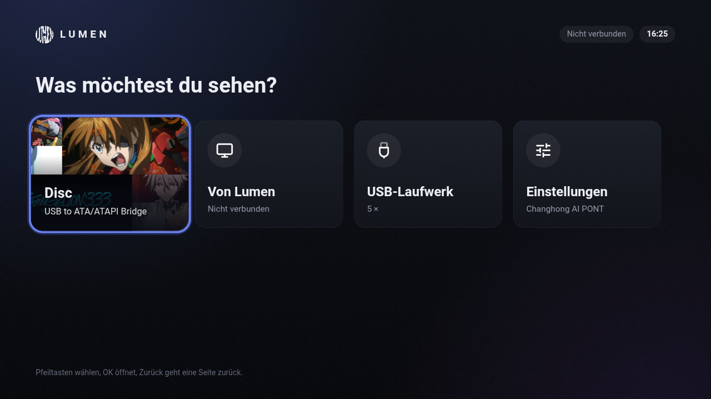
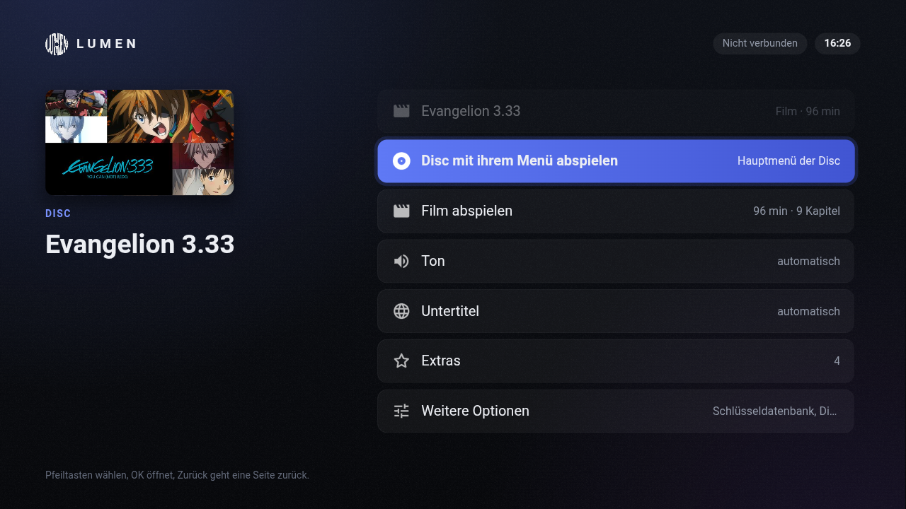
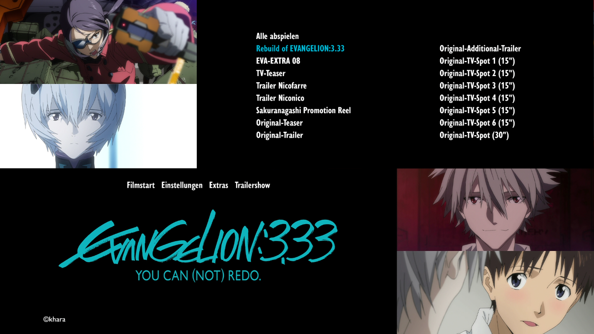
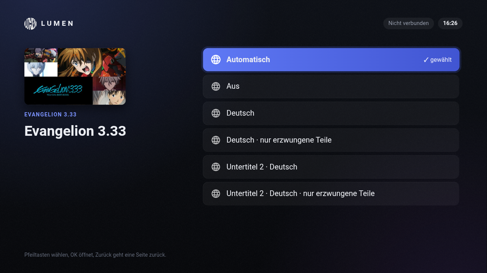

<p align="center"></p>

# Lumen TV

Receiver apps for [Lumen](https://github.com/Karl-Lauterbach24/Lumen), the disc and cinema player.
Lumen TV shows on the television what Lumen plays on the computer: Blu-ray, DVD and Video CD with
their menus, Digital Cinema Packages, files and streams. Lumen encodes its picture and sound and
sends them over the local network; the TV app plays that stream and passes the remote control
back, so disc menus, pause and seeking work from the sofa.

**The Android TV app can also play on its own**: with a USB disc drive or a USB stick plugged into
the television it reads Blu-ray, DVD and files itself, with the disc's own menu, track choice,
covers and episode names – no computer needed.

<p align="center">
  
  
</p>
<p align="center">
  
  
</p>

| Platform | Folder | Package | Technology |
|----------|--------|---------|------------|
| Android TV, Google TV, Fire TV | [`android/`](android) | APK | Kotlin, Media3 (ExoPlayer), FFmpeg audio decoders |
| Samsung TV (Tizen 2.4 and later) | [`tizen/`](tizen) | WGT | web app |
| LG TV (webOS) | [`webos/`](webos) | IPK | web app |
| everything with a browser | – | none | open Lumen's address in the browser |

All of them speak the same small protocol
([`docs/tv-protocol.md`](https://github.com/Karl-Lauterbach24/Lumen/blob/main/docs/tv-protocol.md)
in the Lumen repository). The apps are the receiver page that Lumen itself serves to browsers
(`receiver/` in the Lumen repository) plus a small platform file each; this repository adds the
packaging and, for Android, the native parts. The texts of all apps come from the same table, in
16 languages.

## Using it with Lumen (all platforms)

1. Install the app on the TV (see [docs/install.md](docs/install.md)) or open the TV's browser.
2. In Lumen on the computer, click the cast button and leave the dialog open.
3. Start Lumen TV. It searches the network for Lumen; if it does not find it, enter the address
   the Cast dialog shows (for example `192.168.1.20:47800`). In a browser, open that address.
4. The TV appears in Lumen's Cast dialog. Click it.

Computer and TV must be in the same network, and the computer's firewall has to allow Lumen to
accept connections on the private network (Windows asks the first time).

* 1080p or 720p, H.264 with stereo AAC sound, over HLS. The picture arrives three to four seconds
  after the computer shows it. That is fine for films; disc menus react with that delay.
* HDR sources are tone-mapped to SDR, surround sound is mixed down to stereo, 3D is shown in 2D.
* The computer does the work: it decodes the source and encodes the stream in real time.

Lumen needs version 1.1.0 or later.

## Using it on its own (Android TV)

Plug a USB drive or disc drive into the television and open *Disc* or *USB drive*:

* **Blu-ray, DVD, folders and files** from a drive, with the television's own decoders first and
  FFmpeg for what it cannot decode (Dolby Digital, DTS and DTS-HD, TrueHD).
* **Discs with copy protection** through [MakeMKV](https://www.makemkv.com) – *you* supply its Linux
  files (they are not part of this package, and not in the builds on GitHub); the app runs them
  inside itself and hands them the drive. Needs a television with enough memory (tested on one
  with 1 GB: it works, memory is the limit).
* **The disc's own menu** – studio logos, the menu with its background video and sound, the remote
  moving through the buttons – for discs with a menu of pictures (HDMV). Java menus (BD-J) are not
  supported.
* **Choosing the track**: every audio and subtitle track of a disc, named as the disc's menu names
  it (read from the menu by the app, once per disc), changeable while the film plays.
* **Updates**: it looks daily for a newer Lumen TV and a newer MakeMKV and says so (it does not install them).
* **A disc is recognised**: the disc's own cover, the title, season and disc number; episodes in the
  right order with their names (TVmaze), and the next one starts by itself.

## State of testing

The protocol, the stream and the receiver page are tested automatically in the Lumen repository
(a mock TV app, and playback in a desktop browser). The Android app has been run on one real
television (Changhong, Android TV 11, 32-bit, 929 MB of memory) with Blu-rays from a USB drive,
including a disc with a protected film and its menu. The Samsung and LG apps have not been run on a
real television by the author. Reports and fixes are welcome.

## Building

```bash
git clone https://github.com/Karl-Lauterbach24/Lumen        # the receiver page lives there
git clone https://github.com/Karl-Lauterbach24/Lumen-TV
cd Lumen-TV

python tools/build_web.py --lumen ../Lumen     # dist/tizen, dist/webos, unsigned .wgt
npx -p @webos-tools/cli ares-package dist/webos -o dist      # LG: .ipk
gradle -p android :app:assembleDebug           # Android: android/app/build/outputs/apk/debug
```

The Android build needs JDK 17, the Android SDK and Gradle 8.9 or later.
`tools/gen_android_strings.py --lumen ../Lumen` regenerates the Android texts after the receiver's
texts changed.

Samsung requires every app to be signed with a certificate that names the TV it is installed on,
so there is no ready-to-install Samsung package; the build produces the app folder and an unsigned
archive, and [docs/install.md](docs/install.md) describes how to sign and install it.

## Licence

AGPL-3.0-or-later, like Lumen. The web apps include [hls.js](https://github.com/video-dev/hls.js)
(Apache-2.0) for browsers without built-in HLS; the Android app uses AndroidX Media3 (Apache-2.0) and FFmpeg 6.0 (LGPL) for audio.
